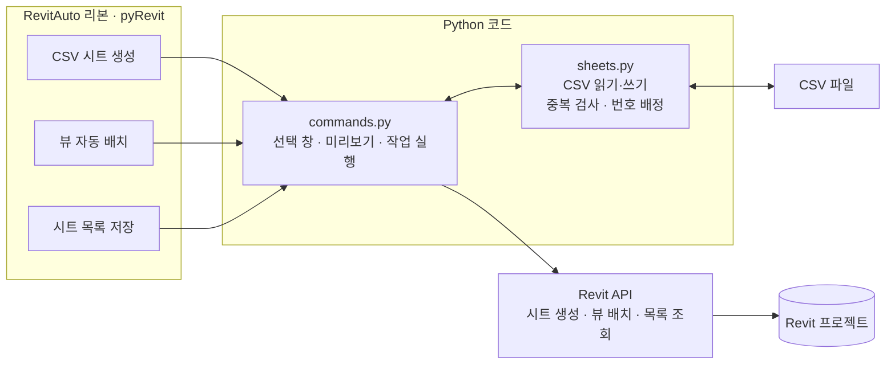

# RevitAuto

**Revit의 시트 작업을 줄이는 Python 플러그인입니다.**

CSV에 적힌 도면 목록으로 시트를 만들고, 선택한 뷰를 새 시트에 배치하고, 시트 목록을 다시 CSV로 저장합니다. [pyRevit](https://github.com/pyrevitlabs/pyRevit)을 통해 Revit 리본에서 실행합니다.

## 한눈에 보는 구조



버튼을 누르면 Python 코드가 입력을 확인한 뒤 Revit API로 도면을 처리합니다. CSV 검사 부분은 Revit을 켜지 않아도 테스트할 수 있습니다.

## 할 수 있는 일

| 버튼 | 사용 방법 | 결과 |
| --- | --- | --- |
| CSV 시트 일괄 생성 | CSV 선택 → 도곽 선택 → 미리보기 확인 | 번호와 이름이 입력된 새 시트 |
| 뷰 → 시트 자동 배치 | 미배치 뷰 여러 개 선택 → 도곽 선택 → 확인 | 뷰마다 새 시트 1개, 중앙에 뷰 배치 |
| 시트 목록 내보내기 | 저장할 위치 선택 | 시트 번호와 이름이 담긴 CSV |

같은 시트 번호가 있으면 생성 전에 알려줍니다. 자동 배치는 기존 번호를 피해서 `RA-001`, `RA-002` 순으로 번호를 붙입니다. 생성 중 오류가 나면 해당 작업을 취소하며, 정상 완료한 작업도 Revit에서 실행 취소 1회로 되돌릴 수 있습니다.

## 설치하기

대상 환경은 **Windows · Revit 2026 · Revit 2026을 지원하는 pyRevit**입니다. 실행에는 pyRevit의 기본 IronPython 엔진을 사용합니다. 별도 C# 빌드나 pip 설치는 필요하지 않습니다.

1. [pyRevit](https://github.com/pyrevitlabs/pyRevit/releases)을 설치하고 Revit에 연결합니다.
2. 이 저장소를 내려받고 폴더 안에서 아래 명령을 실행합니다.
3. Revit을 다시 시작하거나 pyRevit을 Reload합니다. **RevitAuto → 도면 자동화**에 버튼 3개가 나타납니다.

```powershell
git clone https://github.com/youns1998/RevitAuto.git
cd RevitAuto
powershell -ExecutionPolicy Bypass -File scripts/install-extension.ps1
```

설치 위치는 `%APPDATA%\pyRevit\Extensions\RevitAuto.extension`입니다. 다른 위치를 사용하려면 pyRevit Settings의 확장 검색 경로에 `RevitAuto.extension`의 **상위 폴더**를 등록하세요. 코드를 수정한 뒤 설치 명령을 다시 실행하고 Reload하면 갱신됩니다.

이전 C# 버전을 설치했다면 Revit을 닫고 `%APPDATA%\Autodesk\Revit\Addins\2026`의 `Youns.RevitAuto.addin`과 `Youns.RevitAuto` 폴더를 제거한 뒤 전환하세요.

## 바로 써볼 예제

‘CSV 시트 일괄 생성’에서 [samples/house-sheets.csv](samples/house-sheets.csv)를 선택하면 단독주택 시트 5개를 만들 수 있습니다. 직접 작성할 때도 첫 줄은 `Number,Name`으로 맞추고 **UTF-8 CSV**로 저장하세요.

```csv
Number,Name
A101,1층 평면도
A102,2층 평면도
A201,남측 입면도
```

도곽이 없으면 ‘도곽 없이 생성’을 선택합니다. CSV 가져오기는 빈 시트를 생성하며, 뷰 배치는 별도 버튼으로 실행합니다. 자동 배치는 뷰마다 새 시트를 만들고 축척은 유지하므로, 출력 전 용지 여백과 뷰 크기를 확인하세요.

## 코드와 확인 범위

```text
RevitAuto.extension/
├─ RevitAuto.tab/Sheets.panel/     리본 버튼 3개와 실행 스크립트
└─ lib/revitauto/
   ├─ commands.py                 화면 선택과 Revit 작업
   └─ sheets.py                   CSV 처리와 번호 검사
samples/                          단독주택 CSV 예제
tests/                            Python 자동 검사
scripts/                          설치와 검사 실행
```

Revit 없이 검사하려면 일반 Python 3에서 `python scripts/check.py`를 실행합니다. 자동 검사 24개로 한글 CSV, 중복 번호, 자동 번호, 취소·오류 시 작업 처리 등을 확인했습니다. 트랜잭션 검사는 대체 API를 사용한 로직 검사입니다. **실제 Revit에서의 리본 로딩과 모델 변경은 아직 확인하지 않았습니다.** [수동 확인 순서](docs/manual-checks.md)를 참고하세요.

줄바꿈이 들어간 번호·이름은 거부합니다. CSV 저장 시 수식으로 해석될 수 있는 값(`=`, `+`, `-`, `@`로 시작)에는 작은따옴표를 붙이므로 해당 값은 다시 가져올 때 이름이 달라질 수 있습니다. 축척 자동 맞춤, 범례·스케줄 배치, PDF 출력은 포함하지 않습니다.

[단독주택 설계와 Revit 시트 보기](https://youns1998.github.io/portfolioCAD/projects/detail.html?project=two-story-house&document=house-revit-sheets) · [pyRevit 확장 구조](https://docs.pyrevitlabs.io/extensions/) · [pyRevit 설치·경로 안내](https://pyrevitlabs.notion.site/Install-Extensions-0753ab78c0ce46149f962acc50892491)
